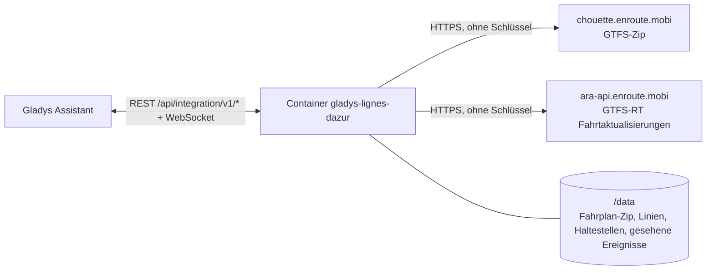
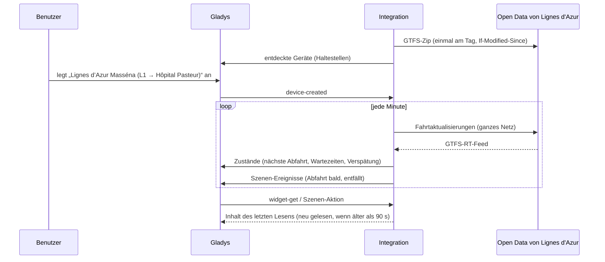
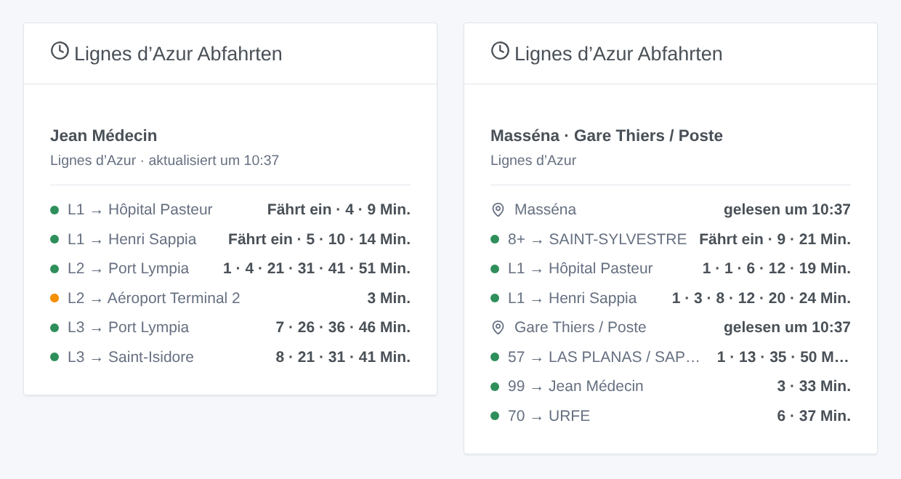

# Gladys Lignes d'Azur Nice

[English](README.md) · [Français](README.fr.md) · **Deutsch** · [Español](README.es.md)

[](LICENSE)
[](https://github.com/William-De71/gladys-lignes-dazur/releases)
[](https://github.com/William-De71/gladys-lignes-dazur/actions/workflows/release.yml)
[](https://gladysassistant.com)


Externe Integration für [Gladys Assistant](https://gladysassistant.com) für **Lignes d’Azur**, die Trams und Busse von Nizza und seiner Métropole: die nächsten Abfahrten an deinen Haltestellen, in Echtzeit korrigiert, mit ihrer Verspätung und den ausgefallenen Fahrten, mit Szenen und einem Dashboard-Widget. Sie liest die offiziellen Open Data des Netzes (GTFS und GTFS-RT), ohne Konto und ohne Schlüssel.

Benutzerdokumentation: [English](docs/en.md) · [Français](docs/fr.md) · [Deutsch](docs/de.md) · [Español](docs/es.md).

> Community-Integration, weder mit Lignes d’Azur noch mit der Métropole Nice Côte d’Azur verbunden oder von ihnen unterstützt.

## Funktionen

- **Ein Gerät pro verfolgter Haltestelle** (drei im Formular, bis zu 10 weitere mit der Schaltfläche **Haltestelle hinzufügen**), per Name oder Bahnsteigcode eingegeben und nach **Linie** und **Richtung** gefiltert: nächste Abfahrt, Wartezeit der nächsten zwei Abfahrten, Verspätung der nächsten.
- **Echtzeit**: die geschätzte Zeit und die Verspätung, sobald die Fahrt verfolgt wird, sonst der Fahrplan (als solcher markiert), die ausgefallenen Fahrten und die nicht bedienten Haltestellen.
- **2 Szenen-Auslöser**, **1 Szenen-Aktion** und **1 Dashboard-Widget** (unten).
- **Eine einzige Anfrage für alle verfolgten Haltestellen**: die Echtzeit des ganzen Netzes standardmäßig jede Minute (30 s bis 5 min, nachts alle 10 min, wenn nichts angekündigt ist), der Fahrplan einmal am Tag und nur, wenn er sich geändert hat (in `/data` gespeichert).
- Schaltflächen der Konfiguration: Verbindung testen, Haltestelle suchen (Bahnsteigcodes, Linien), Haltestellen hinzufügen / entfernen / auflisten, Diagnose.
- Vier Sprachen überall: Englisch, Französisch, Deutsch, Spanisch.

Nicht verfügbar: die **Verkehrslage der Linien**. Lignes d’Azur veröffentlicht keine Verkehrsmeldungen als Open Data (keine Meldung in seinem GTFS-RT, weder GeneralMessage noch SituationExchange in seinem SIRI-Feed).

## Funktionsweise




Beim Start lädt die Integration den Fahrplan (GTFS-Zip, 10 MB) herunter und speichert ihn in `/data`; an den folgenden Tagen fragt sie ihn mit `If-Modified-Since` erneut ab und lädt nur ein neues Zip. Sie liest die Linien (`routes.txt`) und fasst die Bahnsteige eines Namens an einem Ort zu einer Haltestelle zusammen (`stops.txt`: „Jean Médecin“ vereint die Bahnsteige der drei Tramlinien und der Busse; derselbe Name 500 m oder weiter entfernt ist eine andere Haltestelle). Dann löst sie auf, was du eingegeben hast: „tram 1“ ist die Linie `L1`, „5“ der Bus `05`, „massena“ die Haltestelle Masséna, „MASSE2“ die Haltestelle dieses Bahnsteigs. Aus dem Zip zieht sie die Abfahrten der verfolgten Haltestellen über acht Tage (`stop_times.txt` wird als Strom entpackt und Zeile für Zeile gelesen, ohne seine 71 MB je im Speicher zu halten). Mit eigenem Zeitgeber liest sie die Fahrtaktualisierungen des ganzen Netzes (eine Anfrage, egal wie viele Haltestellen) und korrigiert jede Abfahrt ihrer Fahrt mit der Schätzung des Bahnsteigs. Jedes Lesen wird mit dem vorigen verglichen, um die Szenen-Auslöser zu starten.



### Transport

Nur Cloud (`"transports": ["cloud"]`): Der Katalog zeigt das Cloud-Abzeichen. Die Integration kontaktiert `chouette.enroute.mobi` und `ara-api.enroute.mobi`, die Open-Data-Server des Netzes. Es gibt keine lokale Alternative, daher keine Schaltfläche „Lokale Verbindung bevorzugen“.

## Geräte und Funktionen

| Gerät                         | Funktion                           | Kategorie / Typ        | Werte                                                |
| ----------------------------- | ---------------------------------- | ---------------------- | ---------------------------------------------------- |
| Lignes d’Azur \<Haltestelle\> | Nächste Abfahrt                    | `text` / `text`        | „L1 → Hôpital Pasteur · 3 Min. (+2 Min. Verspätung)“ |
| Lignes d’Azur \<Haltestelle\> | Wartezeit, Wartezeit der folgenden | `duration` / `integer` | 0 … 180 Min.                                         |
| Lignes d’Azur \<Haltestelle\> | Verspätung der nächsten Abfahrt    | `duration` / `integer` | 0 … 120 Min.                                         |

Ohne Abfahrt in den nächsten drei Stunden zeigt die Haltestelle die erste Abfahrt am Morgen; die Verspätung wird nur für eine in Echtzeit verfolgte Abfahrt veröffentlicht (eine früher angekündigte Tram zählt 0: Die Trams fahren im Takt).

## Szenen-Auslöser, Aktionen und Widgets



**Szenen-Auslöser** (einmal pro Übergang; das erste Lesen dient als Ausgangswert und löst nichts aus):

- **Abfahrt bald**: Eine Abfahrt an einer verfolgten Haltestelle fährt in 2, 3, 5, 10, 15 oder 20 Minuten, nach ihrer Echtzeit-Schätzung. Filter: Haltestelle, Minuten.
- **Abfahrt entfällt**: Eine Fahrt der nächsten Stunde an einer verfolgten Haltestelle entfällt oder bedient sie nicht. Filter: Haltestelle.

**Szenen-Aktion**: **nächste Abfahrten** einer Haltestelle (Linie, Ziel, Wartezeit, Uhrzeit, Echtzeit oder nicht, Verspätung, die folgende, ein Satz).

**Widget**: **Lignes d’Azur Abfahrten** (eine verfolgte Haltestelle, mehrere in einer Liste oder eine beliebige in den Einstellungen eingegebene Haltestelle).

Beispiele:

- Wenn **die Tram L1 Richtung Hôpital Pasteur in 5 Minuten an Masséna abfährt** → die Flurlampe grün schalten.
- Wenn **eine Abfahrt deiner Haltestelle entfällt** → `{{triggerEvent.data.summary}}` an dein Telefon schicken.
- Jeden Werktag um 7:30 → **die nächsten Abfahrten** deiner Haltestelle lesen und die `summary` vom Küchenlautsprecher sprechen lassen.

## Voraussetzungen

- Gladys Assistant **5.3.0** oder neuer (Widgets und Szenen-Auslöser externer Integrationen, Schlüsselwörter und Länder des Katalogs von Gladys 5.3). Ältere Instanzen können die Integration nicht installieren.
- Sonst nichts: Die Open Data von Lignes d’Azur brauchen weder Konto noch Schlüssel.

## Installation

- **Aus dem Store** von Gladys (Integrationen → Externe Integrationen), mit einem Klick, sobald sie indiziert ist.
- **Über die URL des Repositorys**: `https://github.com/William-De71/gladys-lignes-dazur`.
- **Entwicklermodus**: Baue das Image lokal (`docker build -t gladys-lignes-dazur .`) und installiere es aus Gladys.

## Konfiguration

| Feld                  | Beschreibung                                                                                                     |
| --------------------- | ---------------------------------------------------------------------------------------------------------------- |
| Haltestelle (1 bis 3) | Ein Name, wie er an der Haltestelle steht („Masséna“, „Gare Thiers / Poste“), oder ein Bahnsteigcode („MASSE2“). |
| Linie                 | „L1“, „tram 2“, „5“, „Exp2“. Leer: alle Linien der Haltestelle.                                                  |
| Richtung              | Wörter des Ziels: „Hôpital Pasteur“, „Aéroport \| Port Lympia“. Leer: beide.                                     |
| Lesen der Echtzeit    | 30 s, 1 min (Standard), 2 min oder 5 min.                                                                        |
| Sprache der Texte     | Gerätenamen, Zusammenfassungen und Ausgaben der Szenen.                                                          |

Schaltflächen: **Verbindung testen**, **Haltestelle suchen** (Bahnsteigcodes und Linien jeder gefundenen Haltestelle), **Haltestelle hinzufügen**, **Haltestelle entfernen**, **Haltestellen auflisten** (die Haltestellen über die drei des Formulars hinaus, in der Konfiguration von Gladys gespeichert) und **Diagnose** (schreibt die Haltestellen, den gespeicherten Fahrplan, die letzten Abfahrten, Fehler und Anfragen in den Tab Protokolle).

## Verwendung

1. Gib eine bis drei Haltestellen ein — mehr mit **Haltestelle hinzufügen** — (mit Linie und Richtung, wenn du willst) und speichere.
2. Lege im Tab **Entdecken** die Geräte „Lignes d’Azur …“ an.
3. Füge das Widget **Lignes d’Azur Abfahrten** einem Dashboard hinzu und baue Szenen mit den Auslösern oben.

## Entwicklung

```bash
npm install
npm test                       # node --test, nie mit dem Netz
npm run lint && npm run format:check
npx github:GladysAssistant/integration-store . --skip-image-check
scripts/build-cover.sh         # cover.jpg aus docs/assets/cover.svg
docs/illustrations/render.sh   # docs/assets/widgets.<lang>.png
node .github/scripts/release.mjs next
```

Lokal liest das SDK `GLADYS_HOST_API_URL`, `GLADYS_INTEGRATION_TOKEN` und `GLADYS_INTEGRATION_SELECTOR`; `RLA_GTFS_URL` und `RLA_TRIP_UPDATES_URL` leiten die Integration auf andere Feeds um (eine Attrappe); `DEBUG=gladys-integration-sdk` zeigt die SDK-Protokolle und prüft jeden Widget-Inhalt. Die Tests nutzen echte, reduzierte Open Data von Lignes d’Azur (`test/fixtures/`, Licence Ouverte 2.0): Das Zip wird von `test/helpers/fixtures.js` gebaut und die Feeds kodiert. Die Regeln des Projekts stehen in [CLAUDE.md](CLAUDE.md).

## Release-Prozess


Jeder Merge auf `main` startet die CI und berechnet dann die Version aus den [Conventional Commits](https://www.conventionalcommits.org/) seit dem letzten Tag: `feat` → Minor, `fix` / `perf` → Patch, `!` oder `BREAKING CHANGE` → Major (vor 1.0.0 ein Minor); `docs`, `chore`, `ci`, `test`, `style`, `refactor`, `build` allein veröffentlichen nichts. Der Changelog-Abschnitt wird erzeugt, der Tag gepusht, das Multi-Architektur-Image gebaut, dann erhält `main` den Release-Commit, das GitHub Release wird erstellt, und ein letzter Job prüft das öffentliche Image, den Store-Validator und das Topic.

- Der Titel des Pull Requests wird zum Squash-Commit und dann zur Changelog-Zeile: Schreibe ihn auf Englisch, für die Nutzer (`pr-title.yml` prüft ihn). Bearbeite `CHANGELOG.md` nie von Hand.
- 1.0.0 ist eine Entscheidung: Actions → Release → Run workflow mit `release-as: 1.0.0`. `dry-run` zeigt Version und Notizen, ohne etwas zu veröffentlichen.
- **Geschützter Branch**: Das Release pusht seinen Commit mit `GITHUB_TOKEN` auf `main`. Mit einem Ruleset auf `main`, das strenger ist als „kein Löschen, kein Force-Push“, füge GitHub Actions zu seiner Bypass-Liste hinzu (oder pushe über eine GitHub App), sonst schlägt der Veröffentlichungsjob mit Anweisungen fehl.
- Mache nach dem ersten Release das Paket `ghcr.io` öffentlich (Package settings → Change visibility), sonst kann Gladys es nicht herunterladen.

## Fehlerbehebung

Siehe [docs/de.md](docs/de.md#fehlerbehebung). Melde Probleme mit den Versionen von Gladys und der Integration, der betroffenen Haltestelle und den Zeilen der Schaltfläche **Diagnose**.

## Mitwirken

Issues und Pull Requests sind willkommen. Führe vor einem Pull Request `npm run format:check && npm run lint && npm test` aus und lass alle externen IDs und gespeicherten Schlüssel unverändert (siehe [CLAUDE.md](CLAUDE.md)).

## Sicherheit

Siehe [SECURITY.md](SECURITY.md): Melde Schwachstellen vertraulich. Die Integration braucht kein Geheimnis: Sie liest nur öffentliche Open Data und läuft schreibgeschützt, als Benutzer ohne Root-Rechte, in ihrem Container.

## Kommende Screenshots

Die Bilder oben sind Illustrationen, keine Screenshots. Echte Screenshots kommen nach `docs/assets/screenshots/` (PNG, 1280 × 800): `configuration.png`, `discovery.png`, `device.png`, `scene.png`.

## Lizenz

[Apache License 2.0](LICENSE) — siehe auch [NOTICE](NOTICE). Fahrplan und Echtzeit sind Open Data von Lignes d’Azur (Métropole Nice Côte d’Azur) unter der [Licence Ouverte 2.0](https://www.etalab.gouv.fr/licence-ouverte-open-licence/): Die Widgets zeigen die Quelle und die Uhrzeit jeder Lesung. Danke an die Dokumentation und das SDK von Gladys und an die Métropole Nice Côte d’Azur für die Veröffentlichung dieser Daten in Echtzeit.
