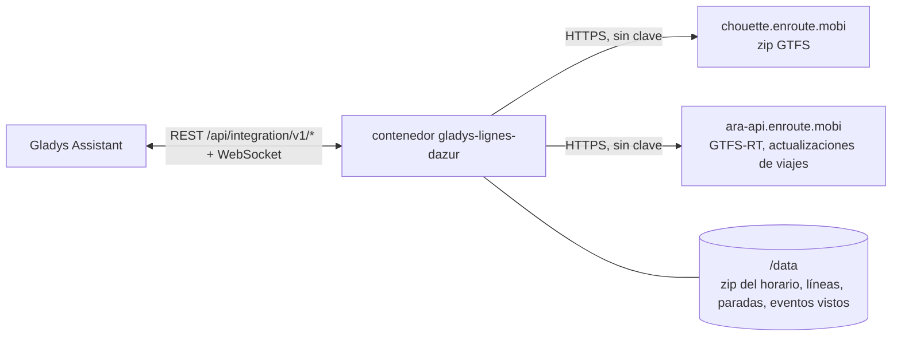
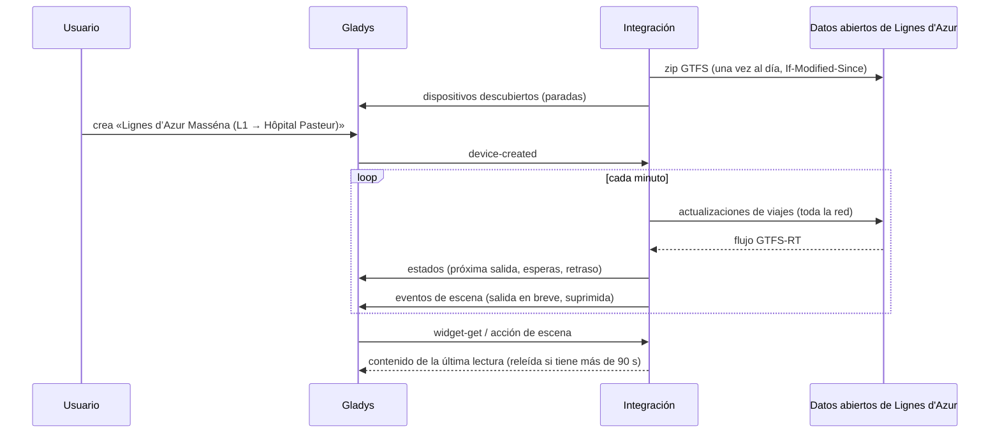
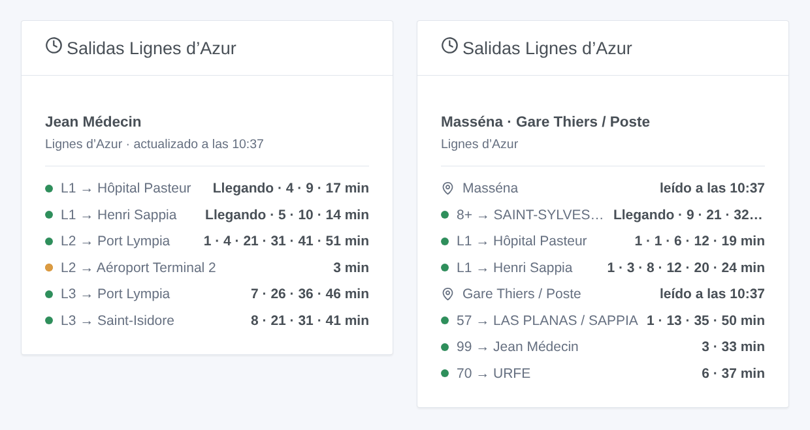

# Gladys Lignes d'Azur Nice

[English](README.md) · [Français](README.fr.md) · [Deutsch](README.de.md) · **Español**

[](LICENSE)
[](https://github.com/William-De71/gladys-lignes-dazur/releases)
[](https://github.com/William-De71/gladys-lignes-dazur/actions/workflows/release.yml)
[](https://gladysassistant.com)


Integración externa de [Gladys Assistant](https://gladysassistant.com) para **Lignes d’Azur**, los tranvías y autobuses de Niza y su Métropole: las próximas salidas en tus paradas, corregidas en tiempo real, con su retraso y los viajes suprimidos, con escenas y un widget de panel. Lee los datos abiertos oficiales de la red (GTFS y GTFS-RT), sin cuenta ni clave.

Documentación de usuario: [English](docs/en.md) · [Français](docs/fr.md) · [Deutsch](docs/de.md) · [Español](docs/es.md).

> Integración comunitaria, sin relación con Lignes d’Azur ni con la Métropole Nice Côte d’Azur, ni respaldada por ellas.

## Funciones

- **Un dispositivo por parada seguida** (tres en el formulario, hasta 10 más con el botón **Añadir una parada**), escrita por su nombre o un código de andén, y filtrada por **línea** y **dirección**: próxima salida, espera de las dos próximas salidas, retraso de la próxima.
- **Tiempo real**: la hora estimada y el retraso en cuanto el viaje se sigue, el horario si no (marcado como tal), los viajes suprimidos y las paradas sin servicio.
- **2 disparadores de escena**, **1 acción de escena** y **1 widget de panel** (abajo).
- **Una sola petición para todas las paradas seguidas**: el tiempo real de toda la red cada minuto por defecto (30 s a 5 min, cada 10 min de noche cuando no se anuncia nada), el horario una vez al día y solo si cambió (guardado en `/data`).
- Botones de configuración: probar la conexión, buscar una parada (códigos de andén, líneas), añadir / quitar / listar paradas, diagnóstico.
- Cuatro idiomas en todas partes: inglés, francés, alemán, español.

No disponible: el **tráfico de las líneas**. Lignes d’Azur no publica avisos de tráfico en datos abiertos (ninguna alerta en su GTFS-RT, ni GeneralMessage ni SituationExchange en su flujo SIRI).

## Funcionamiento




Al arrancar, la integración descarga el horario (zip GTFS, 10 MB) y lo guarda en `/data`; los días siguientes lo vuelve a pedir con `If-Modified-Since` y solo descarga un zip nuevo. Lee las líneas (`routes.txt`) y agrupa los andenes de un mismo nombre en un mismo lugar en una parada (`stops.txt`: «Jean Médecin» reúne los andenes de las tres líneas de tranvía y de los autobuses; el mismo nombre a 500 m o más es otra parada). Después resuelve lo que escribiste: «tram 1» es la línea `L1`, «5» el autobús `05`, «massena» la parada Masséna, «MASSE2» la parada de ese andén. Del zip extrae las salidas de las paradas seguidas durante ocho días (`stop_times.txt` se descomprime en flujo y se lee línea a línea, sin guardar nunca sus 71 MB en memoria). Con su propio temporizador lee las actualizaciones de viajes de toda la red (una petición sea cual sea el número de paradas) y corrige cada salida de su viaje con la estimación del andén. Cada lectura se compara con la anterior para lanzar los disparadores de escena.



### Transporte

Solo nube (`"transports": ["cloud"]`): el catálogo muestra la insignia de nube. La integración contacta con `chouette.enroute.mobi` y `ara-api.enroute.mobi`, los servidores de datos abiertos de la red. No hay alternativa local, así que no hay botón «Preferir la conexión local».

## Dispositivos y funciones

| Dispositivo              | Función                      | Categoría / tipo       | Valores                                            |
| ------------------------ | ---------------------------- | ---------------------- | -------------------------------------------------- |
| Lignes d’Azur \<parada\> | Próximo paso                 | `text` / `text`        | «L1 → Hôpital Pasteur · 3 min (+2 min de retraso)» |
| Lignes d’Azur \<parada\> | Espera, espera del siguiente | `duration` / `integer` | 0 … 180 min                                        |
| Lignes d’Azur \<parada\> | Retraso del próximo paso     | `duration` / `integer` | 0 … 120 min                                        |

Sin salida en las tres horas siguientes, la parada muestra la primera salida de la mañana; el retraso solo se publica para una salida seguida en tiempo real (un tranvía anunciado antes cuenta 0: los tranvías circulan por frecuencia).

## Disparadores, acciones y widgets



**Disparadores de escena** (una vez por transición; la primera lectura sirve de referencia y no dispara nada):

- **Salida en breve**: una salida en una parada seguida sale dentro de 2, 3, 5, 10, 15 o 20 minutos, sobre su estimación en tiempo real. Filtros: parada, minutos.
- **Salida suprimida**: un viaje de la próxima hora en una parada seguida está suprimido o no le da servicio. Filtro: parada.

**Acción de escena**: **próximas salidas** de una parada (línea, destino, espera, hora, tiempo real o no, retraso, la siguiente, una frase).

**Widget**: **Salidas Lignes d’Azur** (una parada seguida, varias en una lista, o cualquier parada escrita en los ajustes).

Ejemplos:

- Cuando **el tranvía L1 hacia Hôpital Pasteur sale de Masséna dentro de 5 minutos** → encender en verde la lámpara de la entrada.
- Cuando **se suprime una salida de tu parada** → enviar `{{triggerEvent.data.summary}}` a tu teléfono.
- Cada día laborable a las 7:30 → **leer las próximas salidas** de tu parada y hacer que el altavoz de la cocina diga el `summary`.

## Requisitos

- Gladys Assistant **5.3.0** o posterior (widgets y disparadores de escena de las integraciones externas, palabras clave y países del catálogo de Gladys 5.3). Las instancias más antiguas no pueden instalar la integración.
- Nada más: los datos abiertos de Lignes d’Azur no piden cuenta ni clave.

## Instalación

- **Desde la tienda** de Gladys (Integraciones → Integraciones externas), en un clic, una vez indexada.
- **Desde la URL del repositorio**: `https://github.com/William-De71/gladys-lignes-dazur`.
- **Modo desarrollador**: construye la imagen en local (`docker build -t gladys-lignes-dazur .`) e instálala desde Gladys.

## Configuración

| Campo                   | Descripción                                                                                                 |
| ----------------------- | ----------------------------------------------------------------------------------------------------------- |
| Parada (1 a 3)          | Un nombre tal como aparece en la parada («Masséna», «Gare Thiers / Poste») o un código de andén («MASSE2»). |
| Línea                   | «L1», «tram 2», «5», «Exp2». Vacío: todas las líneas de la parada.                                          |
| Dirección               | Palabras del destino: «Hôpital Pasteur», «Aéroport \| Port Lympia». Vacío: los dos.                         |
| Lectura del tiempo real | 30 s, 1 min (por defecto), 2 min o 5 min.                                                                   |
| Idioma de los textos    | Nombres de los dispositivos, resúmenes y salidas de las escenas.                                            |

Botones: **Probar la conexión**, **Buscar una parada** (códigos de andén y líneas de cada parada encontrada), **Añadir una parada**, **Quitar una parada**, **Listar las paradas** (las paradas más allá de las tres del formulario, guardadas en la configuración de Gladys) y **Diagnóstico** (escribe las paradas, el horario guardado, las últimas salidas, los errores y las peticiones en la pestaña Registros).

## Uso

1. Escribe de una a tres paradas — más con **Añadir una parada** — (con su línea y su dirección si quieres) y guarda.
2. En la pestaña **Descubrir**, crea los dispositivos «Lignes d’Azur …».
3. Añade el widget **Salidas Lignes d’Azur** a un panel y crea escenas con los disparadores de arriba.

## Desarrollo

```bash
npm install
npm test                       # node --test, nunca toca la red
npm run lint && npm run format:check
npx github:GladysAssistant/integration-store . --skip-image-check
scripts/build-cover.sh         # cover.jpg desde docs/assets/cover.svg
docs/illustrations/render.sh   # docs/assets/widgets.<lang>.png
node .github/scripts/release.mjs next
```

En local, el SDK lee `GLADYS_HOST_API_URL`, `GLADYS_INTEGRATION_TOKEN` y `GLADYS_INTEGRATION_SELECTOR`; `RLA_GTFS_URL` y `RLA_TRIP_UPDATES_URL` dirigen la integración a otros flujos (un simulador); `DEBUG=gladys-integration-sdk` muestra los registros del SDK y comprueba cada contenido de widget. Las pruebas usan datos abiertos reales de Lignes d’Azur, reducidos (`test/fixtures/`, Licence Ouverte 2.0): `test/helpers/fixtures.js` construye el zip y codifica los flujos. Las reglas del proyecto están en [CLAUDE.md](CLAUDE.md).

## Proceso de release


Cada fusión en `main` lanza la CI y luego calcula la versión según los [Conventional Commits](https://www.conventionalcommits.org/) desde la última etiqueta: `feat` → menor, `fix` / `perf` → parche, `!` o `BREAKING CHANGE` → mayor (una menor antes de 1.0.0); `docs`, `chore`, `ci`, `test`, `style`, `refactor`, `build` solos no publican nada. Se genera la sección del changelog, se sube la etiqueta, se construye la imagen multiarquitectura, luego `main` recibe el commit de release, se crea la GitHub Release y un último job comprueba la imagen pública, el validador de la tienda y el topic.

- El título del pull request se convierte en el commit squash y luego en la línea del changelog: escríbelo en inglés, para el usuario (`pr-title.yml` lo comprueba). No edites nunca `CHANGELOG.md` a mano.
- La 1.0.0 es una decisión: Actions → Release → Run workflow con `release-as: 1.0.0`. `dry-run` muestra la versión y las notas sin publicar nada.
- **Rama protegida**: la release sube su commit a `main` con `GITHUB_TOKEN`. Con un ruleset en `main` más estricto que «sin borrado, sin force-push», añade GitHub Actions a su lista de exclusión (o sube mediante una GitHub App); si no, el job de publicación falla con instrucciones.
- Tras la primera release, haz público el paquete `ghcr.io` (Package settings → Change visibility); si no, Gladys no puede descargarlo.

## Solución de problemas

Consulta [docs/es.md](docs/es.md#solución-de-problemas). Informa de los problemas con las versiones de Gladys y de la integración, la parada afectada y las líneas del botón **Diagnóstico**.

## Contribuir

Issues y pull requests bienvenidos. Ejecuta `npm run format:check && npm run lint && npm test` antes de abrir un pull request, y mantén sin cambios todos los identificadores externos y claves guardadas (ver [CLAUDE.md](CLAUDE.md)).

## Seguridad

Consulta [SECURITY.md](SECURITY.md): informa de las vulnerabilidades en privado. La integración no necesita ningún secreto: solo lee datos abiertos públicos, y se ejecuta en solo lectura, con un usuario sin privilegios de root, en su contenedor.

## Capturas por venir

Las imágenes de arriba son ilustraciones, no capturas de pantalla. Las capturas reales irán en `docs/assets/screenshots/` (PNG, 1280 × 800): `configuration.png`, `discovery.png`, `device.png`, `scene.png`.

## Licencia

[Licencia Apache 2.0](LICENSE) — ver también [NOTICE](NOTICE). El horario y el tiempo real son datos abiertos de Lignes d’Azur (Métropole Nice Côte d’Azur) bajo la [Licence Ouverte 2.0](https://www.etalab.gouv.fr/licence-ouverte-open-licence/): los widgets muestran la fuente y la hora de cada lectura. Gracias a la documentación y al SDK de Gladys, y a la Métropole Nice Côte d’Azur por publicar estos datos en tiempo real.
