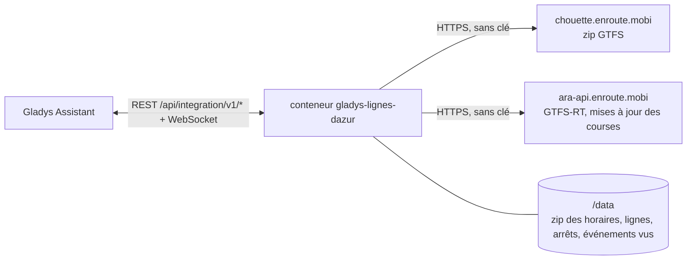
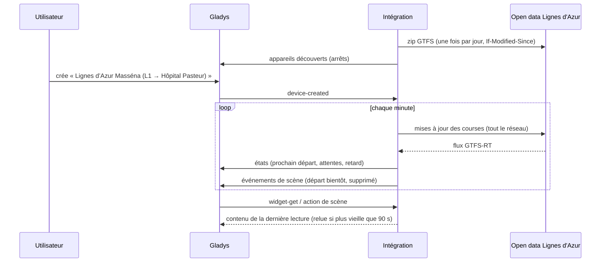
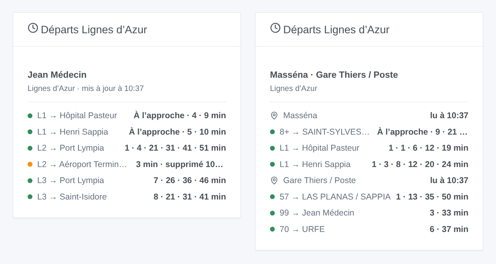

# Gladys Lignes d'Azur Nice

[English](README.md) · **Français** · [Deutsch](README.de.md) · [Español](README.es.md)

[](LICENSE)
[](https://github.com/William-De71/gladys-lignes-dazur/releases)
[](https://github.com/William-De71/gladys-lignes-dazur/actions/workflows/release.yml)
[](https://gladysassistant.com)


Intégration externe [Gladys Assistant](https://gladysassistant.com) pour **Lignes d’Azur**, les trams et bus de Nice et de sa Métropole : les prochains départs à vos arrêts, corrigés en temps réel, avec leur retard et les courses supprimées, avec scènes et widget de tableau de bord. Elle lit l’open data officiel du réseau (GTFS et GTFS-RT), sans compte ni clé.

Documentation utilisateur : [English](docs/en.md) · [Français](docs/fr.md) · [Deutsch](docs/de.md) · [Español](docs/es.md).

> Intégration communautaire, ni affiliée ni approuvée par Lignes d’Azur ou la Métropole Nice Côte d’Azur.

## Fonctionnalités

- **Un appareil par arrêt suivi** (trois dans le formulaire, jusqu’à 10 de plus avec le bouton **Ajouter un arrêt**), saisi par son nom ou un code de quai, et filtré par **ligne** et **direction** : prochain départ, attente des deux prochains départs, retard du prochain.
- **Temps réel** : l’heure estimée et le retard dès que la course est suivie, les horaires sinon (signalés comme tels), les courses supprimées et les arrêts non desservis.
- **2 déclencheurs de scène**, **1 action de scène** et **1 widget de tableau de bord** (ci-dessous).
- **Une seule requête pour tous les arrêts suivis** : le temps réel de tout le réseau toutes les minutes par défaut (30 s à 5 min, toutes les 10 min la nuit quand rien n’est annoncé), les horaires une fois par jour seulement s’ils ont changé (gardés dans `/data`).
- Boutons de configuration : tester la connexion, chercher un arrêt (codes de quai, lignes), ajouter / retirer / lister des arrêts, diagnostic.
- Quatre langues partout : anglais, français, allemand, espagnol.

Pas disponible : le **trafic des lignes**. Lignes d’Azur ne publie pas d’alerte trafic en open data (pas d’alerte dans son GTFS-RT, ni GeneralMessage ni SituationExchange dans son flux SIRI).

## Fonctionnement




Au démarrage, l’intégration télécharge les horaires (zip GTFS, 10 Mo) et les garde dans `/data` ; les jours suivants, elle les redemande avec `If-Modified-Since` et ne télécharge qu’un nouveau zip. Elle lit les lignes (`routes.txt`) et regroupe les quais d’un même nom au même endroit en un arrêt (`stops.txt` : « Jean Médecin » réunit les quais des trois lignes de tram et des bus ; le même nom à 500 m ou plus est un autre arrêt). Elle résout ensuite ce que vous avez saisi : « tram 1 » est la ligne `L1`, « 5 » le bus `05`, « massena » l’arrêt Masséna, « MASSE2 » l’arrêt de ce quai. Du zip, elle extrait les départs des arrêts suivis sur huit jours (`stop_times.txt` est décompressé en flux et lu ligne à ligne, sans jamais garder ses 71 Mo en mémoire). Sur son propre minuteur, elle lit les mises à jour des courses de tout le réseau (une requête quel que soit le nombre d’arrêts) et corrige chaque départ de sa course avec l’estimation du quai. Chaque lecture est comparée à la précédente pour lancer les déclencheurs de scène.



### Transport

Cloud uniquement (`"transports": ["cloud"]`) : le catalogue affiche le badge cloud. L’intégration contacte `chouette.enroute.mobi` et `ara-api.enroute.mobi`, les serveurs open data du réseau. Il n’existe pas d’alternative locale, donc pas de bouton « Préférer la connexion locale ».

## Appareils et fonctionnalités

| Appareil                | Fonctionnalité              | Catégorie / type       | Valeurs                                             |
| ----------------------- | --------------------------- | ---------------------- | --------------------------------------------------- |
| Lignes d’Azur \<arrêt\> | Prochain passage            | `text` / `text`        | « L1 → Hôpital Pasteur · 3 min (+2 min de retard) » |
| Lignes d’Azur \<arrêt\> | Attente, attente du suivant | `duration` / `integer` | 0 … 180 min                                         |
| Lignes d’Azur \<arrêt\> | Retard du prochain passage  | `duration` / `integer` | 0 … 120 min                                         |

Sans départ dans les trois heures, l’arrêt montre le premier départ du matin ; le retard n’est publié que pour un départ suivi en temps réel (un tram annoncé en avance compte 0 : les trams circulent à la fréquence).

## Déclencheurs, actions et widgets



**Déclencheurs de scène** (une fois par transition ; la première lecture sert de référence et ne déclenche rien) :

- **Départ bientôt** : un départ à un arrêt suivi part dans 2, 3, 5, 10, 15 ou 20 minutes, sur son heure estimée en temps réel. Filtres : arrêt, minutes.
- **Départ supprimé** : une course de l’heure à venir à un arrêt suivi est supprimée ou ne le dessert pas. Filtre : arrêt.

**Action de scène** : **prochains départs** d’un arrêt (ligne, destination, attente, heure, temps réel ou non, retard, le suivant, une phrase).

**Widget** : **Départs Lignes d’Azur** (un arrêt suivi, plusieurs dans une liste, ou n’importe quel arrêt saisi dans les réglages).

Exemples :

- Quand **le tram L1 vers Hôpital Pasteur part de Masséna dans 5 minutes** → allumer la lampe de l’entrée en vert.
- Quand **un départ de votre arrêt est supprimé** → envoyer `{{triggerEvent.data.summary}}` sur votre téléphone.
- Chaque jour de semaine à 7 h 30 → **lire les prochains départs** de votre arrêt et faire dire le `summary` par l’enceinte de la cuisine.

## Prérequis

- Gladys Assistant **5.3.0** ou plus récent (widgets et déclencheurs de scène des intégrations externes, mots-clés et pays du catalogue de Gladys 5.3). Les instances plus anciennes ne peuvent pas installer l’intégration.
- Rien d’autre : l’open data de Lignes d’Azur ne demande ni compte ni clé.

## Installation

- **Depuis le store** de Gladys (Intégrations → Intégrations externes), en un clic, une fois indexée.
- **Depuis l’URL du dépôt** : `https://github.com/William-De71/gladys-lignes-dazur`.
- **Mode développeur** : construisez l’image en local (`docker build -t gladys-lignes-dazur .`) et installez-la depuis Gladys.

## Configuration

| Champ                 | Description                                                                                           |
| --------------------- | ----------------------------------------------------------------------------------------------------- |
| Arrêt (1 à 3)         | Un nom tel qu’écrit à l’arrêt (« Masséna », « Gare Thiers / Poste ») ou un code de quai (« MASSE2 »). |
| Ligne                 | « L1 », « tram 2 », « 5 », « Exp2 ». Vide : toutes les lignes de l’arrêt.                             |
| Direction             | Mots de la destination : « Hôpital Pasteur », « Aéroport \| Port Lympia ». Vide : les deux.           |
| Lecture du temps réel | 30 s, 1 min (par défaut), 2 min ou 5 min.                                                             |
| Langue des textes     | Noms des appareils, résumés et sorties des scènes.                                                    |

Boutons : **Tester la connexion**, **Chercher un arrêt** (codes de quai et lignes de chaque arrêt trouvé), **Ajouter un arrêt**, **Retirer un arrêt**, **Lister les arrêts** (les arrêts au-delà des trois du formulaire, gardés dans la configuration de Gladys) et **Diagnostic** (écrit les arrêts, les horaires gardés, les derniers départs, les erreurs et les requêtes dans l’onglet Journaux).

## Utilisation

1. Saisissez un à trois arrêts — plus avec **Ajouter un arrêt** — (avec leur ligne et leur direction si vous voulez), puis enregistrez.
2. Dans l’onglet **Découvrir**, créez les appareils « Lignes d’Azur … ».
3. Ajoutez le widget **Départs Lignes d’Azur** à un tableau de bord, et construisez des scènes avec les déclencheurs ci-dessus.

## Développement

```bash
npm install
npm test                       # node --test, ne touche jamais le réseau
npm run lint && npm run format:check
npx github:GladysAssistant/integration-store . --skip-image-check
scripts/build-cover.sh         # cover.jpg depuis docs/assets/cover.svg
docs/illustrations/render.sh   # docs/assets/widgets.<lang>.png
node .github/scripts/release.mjs next
```

En local, le SDK lit `GLADYS_HOST_API_URL`, `GLADYS_INTEGRATION_TOKEN` et `GLADYS_INTEGRATION_SELECTOR` ; `RLA_GTFS_URL` et `RLA_TRIP_UPDATES_URL` dirigent l’intégration vers d’autres flux (un simulateur) ; `DEBUG=gladys-integration-sdk` affiche les journaux du SDK et vérifie chaque contenu de widget. Les tests utilisent de vraies données ouvertes de Lignes d’Azur, réduites (`test/fixtures/`, Licence Ouverte 2.0) : le zip est construit et les flux encodés par `test/helpers/fixtures.js`. Les règles du projet sont dans [CLAUDE.md](CLAUDE.md).

## Processus de release


Chaque fusion sur `main` lance la CI, puis calcule la version d’après les [Conventional Commits](https://www.conventionalcommits.org/) depuis le dernier tag : `feat` → mineure, `fix` / `perf` → correctif, `!` ou `BREAKING CHANGE` → majeure (une mineure avant 1.0.0) ; `docs`, `chore`, `ci`, `test`, `style`, `refactor`, `build` seuls ne publient rien. La section du changelog est générée, le tag poussé, l’image multi-architecture construite, puis `main` reçoit le commit de release, la GitHub Release est créée et un dernier job vérifie l’image publique, le validateur du store et le topic.

- Le titre de la pull request devient le commit squash, puis la ligne du changelog : écrivez-le en anglais, pour l’utilisateur (`pr-title.yml` le vérifie). N’éditez jamais `CHANGELOG.md` à la main.
- La 1.0.0 est une décision : Actions → Release → Run workflow avec `release-as: 1.0.0`. `dry-run` montre la version et les notes sans rien publier.
- **Branche protégée** : la release pousse son commit sur `main` avec `GITHUB_TOKEN`. Avec un ruleset sur `main` plus strict que « pas de suppression, pas de force-push », ajoutez GitHub Actions à sa liste de contournement (ou poussez via une GitHub App), sinon le job de publication échoue avec des instructions.
- Après la première release, rendez public le paquet `ghcr.io` (Package settings → Change visibility), sinon Gladys ne peut pas le télécharger.

## Dépannage

Voir [docs/fr.md](docs/fr.md#dépannage). Signalez les problèmes avec les versions de Gladys et de l’intégration, l’arrêt concerné, et les lignes du bouton **Diagnostic**.

## Contribuer

Issues et pull requests bienvenues. Lancez `npm run format:check && npm run lint && npm test` avant d’ouvrir une pull request, et gardez inchangés tous les identifiants externes et clés stockées (voir [CLAUDE.md](CLAUDE.md)).

## Sécurité

Voir [SECURITY.md](SECURITY.md) : signalez les vulnérabilités en privé. L’intégration n’a besoin d’aucun secret : elle ne lit que des données ouvertes publiques, et tourne en lecture seule, sous un utilisateur non root, dans son conteneur.

## Captures à venir

Les images ci-dessus sont des illustrations, pas des captures d’écran. Les vraies captures iront dans `docs/assets/screenshots/` (PNG, 1280 × 800) : `configuration.png`, `discovery.png`, `device.png`, `scene.png`.

## Licence

[Licence Apache 2.0](LICENSE) — voir aussi [NOTICE](NOTICE). Les horaires et le temps réel sont des données ouvertes de Lignes d’Azur (Métropole Nice Côte d’Azur) sous [Licence Ouverte 2.0](https://www.etalab.gouv.fr/licence-ouverte-open-licence/) : les widgets affichent la source et l’heure de chaque lecture. Merci à la documentation et au SDK de Gladys, et à la Métropole Nice Côte d’Azur de publier ces données en temps réel.
