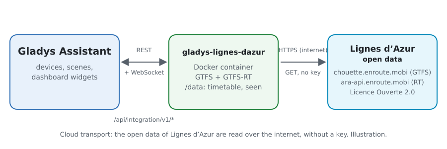
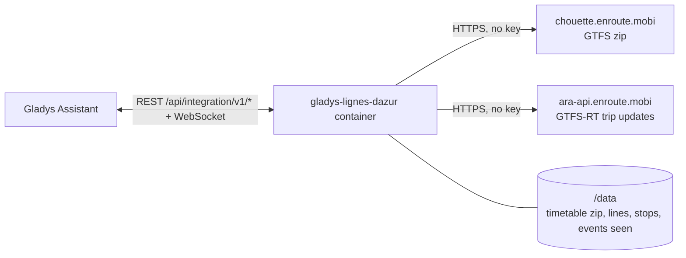
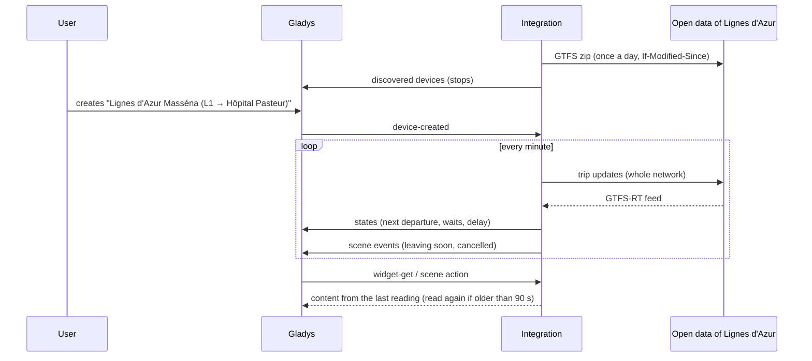
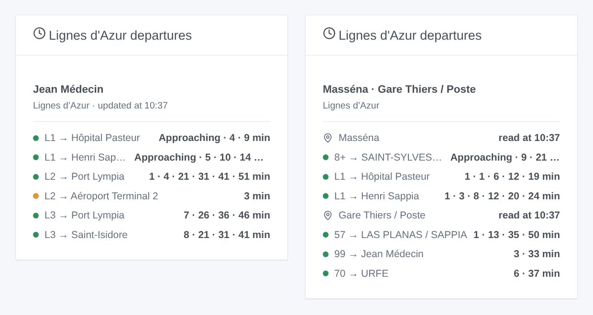

# Gladys Lignes d'Azur Nice

**English** · [Français](README.fr.md) · [Deutsch](README.de.md) · [Español](README.es.md)

[](LICENSE)
[](https://github.com/William-De71/gladys-lignes-dazur/releases)
[](https://github.com/William-De71/gladys-lignes-dazur/actions/workflows/release.yml)
[](https://gladysassistant.com)


[Gladys Assistant](https://gladysassistant.com) external integration for **Lignes d'Azur**, the trams and buses of Nice and its Métropole: the next departures at your stops, corrected in real time, with their delay and the cancelled trips, with scenes and a dashboard widget. It reads the official open data of the network (GTFS and GTFS-RT), without an account or a key.

User documentation: [English](docs/en.md) · [Français](docs/fr.md) · [Deutsch](docs/de.md) · [Español](docs/es.md).

> Community integration, not affiliated with nor endorsed by Lignes d'Azur or the Métropole Nice Côte d'Azur.

## Features

- **One device per followed stop** (three in the form, up to 10 more with the **Add a stop** button), typed by name or by platform code, and filtered by **line** and **direction**: next departure, wait of the next two departures, delay of the next one.
- **Real time**: the estimated time and the delay once the trip is followed, the timetable otherwise (marked as such), the cancelled trips and the stops not served.
- **2 scene triggers**, **1 scene action** and **1 dashboard widget** (below).
- **One request for every followed stop**: the real time of the whole network every minute by default (30 s to 5 min, every 10 min at night when nothing is announced), the timetable once a day only when it changed (kept in `/data`).
- Configuration buttons: test the connection, find a stop (platform codes, lines), add / remove / list stops, diagnostic.
- Four languages everywhere: English, French, German, Spanish.

Not available: the **traffic of the lines**. Lignes d'Azur publishes no traffic alert in open data (no service alert in its GTFS-RT, no GeneralMessage nor SituationExchange in its SIRI feed).

## How it works





At start, the integration downloads the timetable (GTFS zip, 10 MB) and keeps it in `/data`; the next days it asks for it again with `If-Modified-Since` and only downloads a new one. It reads the lines (`routes.txt`) and gathers the platforms of one name in one place into a stop (`stops.txt`: "Jean Médecin" holds the platforms of the three tram lines and of the buses; the same name 500 m away or more is another stop). It then resolves what you typed: "tram 1" is the line `L1`, "5" the bus `05`, "massena" the stop Masséna, "MASSE2" the stop of that platform. From the zip it extracts the departures of the followed stops over eight days (`stop_times.txt` is inflated as a stream and read line by line, without ever holding its 71 MB in memory). On its own timer it reads the trip updates of the whole network (one request whatever the number of stops) and corrects each departure of its trip with the estimate of the platform. Each reading is compared with the previous one to fire the scene triggers.



### Transport

Cloud only (`"transports": ["cloud"]`): the catalog shows the cloud badge. The integration contacts `chouette.enroute.mobi` and `ara-api.enroute.mobi`, the open data servers of the network. There is no local alternative, so there is no "prefer the local connection" button.

## Devices and features

| Device                 | Feature                      | Category / type        | Values                                       |
| ---------------------- | ---------------------------- | ---------------------- | -------------------------------------------- |
| Lignes d'Azur \<stop\> | Next passage                 | `text` / `text`        | "L1 → Hôpital Pasteur · 3 min (+2 min late)" |
| Lignes d'Azur \<stop\> | Wait, wait for the following | `duration` / `integer` | 0 … 180 min                                  |
| Lignes d'Azur \<stop\> | Delay of the next passage    | `duration` / `integer` | 0 … 120 min                                  |

Without any departure in the next three hours, the stop shows the first departure of the morning; the delay is published only for a departure followed in real time (a tram announced early counts 0: the trams run to a frequency).

## Scene triggers, actions and widgets



**Scene triggers** (once per transition; the first reading is a reference and fires nothing):

- **Departure soon**: a departure at a followed stop leaves in 2, 3, 5, 10, 15 or 20 minutes, on its real-time estimate. Filters: stop, minutes.
- **Departure cancelled**: a trip of the next hour at a followed stop is cancelled or does not serve it. Filter: stop.

**Scene action**: **next departures** of a stop (line, destination, wait, time, real time or not, delay, the following one, a sentence).

**Widget**: **Lignes d'Azur departures** (a followed stop, several in one list, or any stop typed in the settings).

Examples:

- When **the tram L1 towards Hôpital Pasteur leaves Masséna in 5 minutes** → light the hall lamp in green.
- When **a departure of your stop is cancelled** → send `{{triggerEvent.data.summary}}` to your phone.
- Every weekday at 7:30 → **read the next departures** of your stop and have the `summary` spoken by the kitchen speaker.

## Requirements

- Gladys Assistant **5.3.0** or later (widgets and scene triggers of external integrations, catalog keywords and countries of Gladys 5.3). Older instances cannot install the integration.
- Nothing else: the open data of Lignes d'Azur need neither an account nor a key.

## Installation

- **From the store** of Gladys (Integrations → External integrations), in one click, once indexed.
- **From the repository URL**: `https://github.com/William-De71/gladys-lignes-dazur`.
- **Developer mode**: build the image locally (`docker build -t gladys-lignes-dazur .`) and install it from Gladys.

## Configuration

| Field                    | Description                                                                                     |
| ------------------------ | ----------------------------------------------------------------------------------------------- |
| Stop (1 to 3)            | A name as written on the stop ("Masséna", "Gare Thiers / Poste") or a platform code ("MASSE2"). |
| Line                     | "L1", "tram 2", "5", "Exp2". Empty: every line of the stop.                                     |
| Direction                | Words of the destination: "Hôpital Pasteur", "Aéroport \| Port Lympia". Empty: both.            |
| Reading of the real time | 30 s, 1 min (default), 2 min or 5 min.                                                          |
| Language of the texts    | Device names, scene summaries and outputs.                                                      |

Buttons: **Test the connection**, **Find a stop** (platform codes and lines of each stop found), **Add a stop**, **Remove a stop**, **List the stops** (the stops beyond the three of the form, kept in the Gladys configuration) and **Diagnostic** (writes the stops, timetable kept, last departures, errors and requests to the Logs tab).

## Usage

1. Enter one to three stops — more with **Add a stop** — (with their line and direction if you wish), then save.
2. In the **Discover** tab, create the "Lignes d'Azur …" devices.
3. Add the **Lignes d'Azur departures** widget to a dashboard, and build scenes with the triggers above.

## Development

```bash
npm install
npm test                       # node --test, never touches the network
npm run lint && npm run format:check
npx github:GladysAssistant/integration-store . --skip-image-check
scripts/build-cover.sh         # cover.jpg from docs/assets/cover.svg
docs/illustrations/render.sh   # docs/assets/widgets.<lang>.png
node .github/scripts/release.mjs next
```

Locally, the SDK reads `GLADYS_HOST_API_URL`, `GLADYS_INTEGRATION_TOKEN` and `GLADYS_INTEGRATION_SELECTOR`; `RLA_GTFS_URL` and `RLA_TRIP_UPDATES_URL` point the integration to other feeds (a mock); `DEBUG=gladys-integration-sdk` shows the SDK logs and checks every widget content. The tests use real open data of Lignes d'Azur, reduced (`test/fixtures/`, Licence Ouverte 2.0): the zip is built and the feeds encoded by `test/helpers/fixtures.js`. The rules of the project are in [CLAUDE.md](CLAUDE.md).

## Release process


Every merge on `main` runs the CI, then computes the version from the [Conventional Commits](https://www.conventionalcommits.org/) since the last tag: `feat` → minor, `fix` / `perf` → patch, `!` or `BREAKING CHANGE` → major (a minor below 1.0.0); `docs`, `chore`, `ci`, `test`, `style`, `refactor`, `build` alone publish nothing. The changelog section is generated, the tag pushed, the multi-architecture image built, then `main` receives the release commit, the GitHub Release is created and a last job checks the public image, the store validator and the topic.

- The pull request title becomes the squash commit, then the changelog line: write it in English, for the user (`pr-title.yml` checks it). Never edit `CHANGELOG.md` by hand.
- 1.0.0 is a decision: Actions → Release → Run workflow with `release-as: 1.0.0`. `dry-run` shows the version and the notes without publishing.
- **Protected branch**: the release pushes its commit to `main` with `GITHUB_TOKEN`. With a ruleset on `main` stricter than "no deletion, no force-push", add GitHub Actions to its bypass list (or push through a GitHub App), otherwise the publish job fails with instructions.
- After the first release, make the `ghcr.io` package public (Package settings → Change visibility), or Gladys cannot pull it.

## Troubleshooting

See [docs/en.md](docs/en.md#troubleshooting). Report issues with the versions of Gladys and of the integration, the stop concerned, and the lines of the **Diagnostic** button.

## Contributing

Issues and pull requests are welcome. Run `npm run format:check && npm run lint && npm test` before opening a pull request, and keep every external id and stored key unchanged (see [CLAUDE.md](CLAUDE.md)).

## Security

See [SECURITY.md](SECURITY.md): report vulnerabilities privately. The integration needs no secret: it only reads public open data, and runs read-only, as a non-root user, in its container.

## Screenshots to come

The images above are illustrations, not screenshots. Real screenshots will go in `docs/assets/screenshots/` (PNG, 1280 × 800): `configuration.png`, `discovery.png`, `device.png`, `scene.png`.

## License

[Apache License 2.0](LICENSE) — see also [NOTICE](NOTICE). The timetable and the real time are open data of Lignes d'Azur (Métropole Nice Côte d'Azur) under the [Licence Ouverte 2.0](https://www.etalab.gouv.fr/licence-ouverte-open-licence/): the widgets show the source and the time of each reading. Thanks to the Gladys documentation and SDK, and to the Métropole Nice Côte d'Azur for publishing these data in real time.
